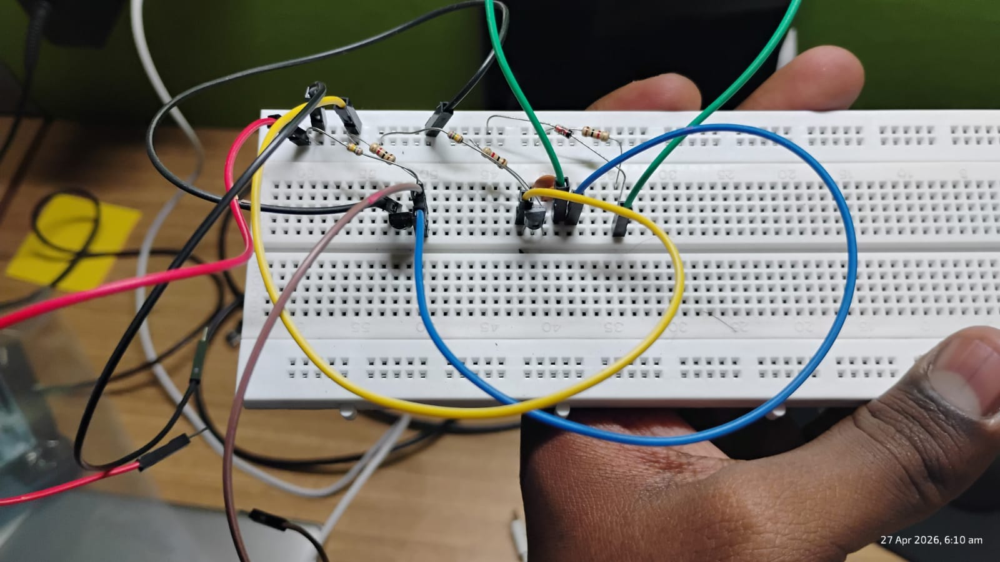
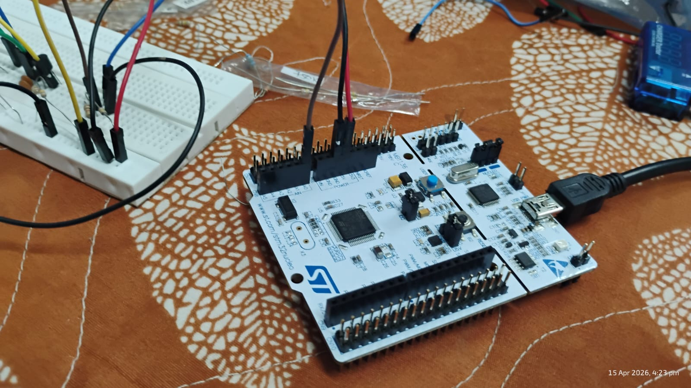
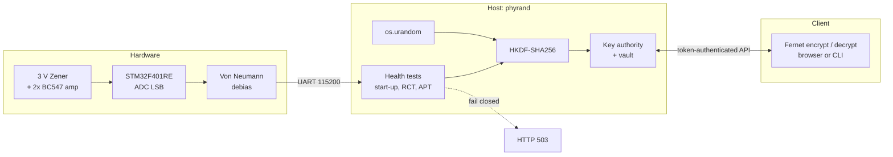

# PhyRand

**A Zener-noise entropy source on an STM32, a health-tested key-generation pipeline, and a key-escrow service with client-side file encryption.**

[](https://github.com/Kavin-Re/PhyRand/actions/workflows/ci.yml)


[](LICENSE)

PhyRand is an end-to-end hardware-security exercise: build a physical noise
source on a breadboard, digitise and debias it on a microcontroller, treat
that source as *untrusted* on the host, and only then turn it into
cryptographic keys.

> **Status.** Research prototype, not audited, not for protecting real
> secrets. The noise source is unvalidated; the claims this project does and
> does not make are listed under [Security model](#security-model-and-limitations).

| Breadboard noise front end | NUCLEO-F401RE |
| :---: | :---: |
|  |  |

## Highlights

* **Analogue front end**: reverse-biased 3 V Zener, two AC-coupled BC547 gain
  stages, sampled on the STM32's 12-bit ADC ([hardware notes](docs/HARDWARE.md)).
* **Firmware**: LSB extraction and Von Neumann debiasing on an STM32F401RE,
  streamed over UART ([firmware notes](firmware/README.md)).
* **Untrusted-source pipeline**: start-up and continuous health tests modelled
  on NIST SP 800-90B (Repetition Count, Adaptive Proportion), then HKDF-SHA256
  conditioning mixed with the OS CSPRNG, so a failed noise source can stop key
  issuance but can never weaken a key.
* **Fail closed**: no healthy hardware, no key (HTTP 503), unless an OS-only
  fallback is explicitly enabled, in which case every response says so.
* **Key-escrow API** (FastAPI): strong-token enforcement, constant-time
  comparison, rate limiting, per-file release tokens, atomic owner-only vault.
* **Browser client with no third-party code**: Fernet on WebCrypto, strict
  Content-Security-Policy, MAC verified before decryption.
* **Tested without hardware**: 134 Python tests and 8 JavaScript tests run
  against a fake serial source, RFC 5869 vectors, SP 800-90B cutoff values and
  the Fernet spec vectors.

## Architecture



Details, the health-test state machine and the key-lifecycle sequence diagram
are in [docs/ARCHITECTURE.md](docs/ARCHITECTURE.md).

## Results

All figures come from the one capture in this repository,
[`data/random_whitened.bin`](data/README.md) (1,000,000 bytes of debiased
output), and are reproducible with `python -m phyrand analyze data/random_whitened.bin`.
The test suite pins them so this table cannot drift from the data.

| Statistic | Measured | Ideal | Verdict |
| :--- | :--- | :--- | :--- |
| Shannon entropy (`ent`) | 7.9997 bits/byte | 8 | Close to flat histogram |
| MCV min-entropy estimate (SP 800-90B 6.3.1) | 7.87 bits/byte | 8 | One estimator, conditioned data only |
| Chi-square, 255 d.o.f. | 331.58 (p = 0.0009) | p not extreme | **Fails** at 1 % |
| Ones fraction | 0.499225 (z = -4.4) | 0.5 | **Fails** monobit |
| Serial correlation | +0.0067 | 0 | Small but significant |
| RCT / APT health tests | 0 failures | 0 | Pass |

The honest reading: the output *looks* random at a glance, and the
often-quoted 7.9997 bits/byte is real, but a million samples are enough to
expose a residual bias. It sits almost entirely in the first bit of every
byte (z = -7.8), which points at the firmware's sampling loop rather than the
diode ([analysis](data/README.md), [firmware review](firmware/README.md)).
This is exactly why the host never uses device bytes as keys directly.

Not yet done: NIST SP 800-22 and SP 800-90B runs, raw (pre-debias) sample
analysis, oscilloscope characterisation, and the control experiment with the
Zener removed.

## Hardware

| Qty | Part | Role |
| :-- | :--- | :--- |
| 1 | STM32 NUCLEO-F401RE | ADC, debiasing, UART via on-board ST-LINK |
| 1 | 3 V Zener diode | Noise source, reverse biased through 1 kΩ from 3.3 V |
| 2 | BC547 NPN transistor | Common-emitter gain stages |
| 2 | 10 nF ceramic capacitor | AC coupling |
| 3 | 1 kΩ resistor | Zener series resistor, two collector loads |
| 2 | 750 kΩ resistor | Base bias |
| 1 | Breadboard and jumpers | |

Wiring table, schematic diagram, photos and bring-up log:
[docs/HARDWARE.md](docs/HARDWARE.md).

## Quick start

Requires Python 3.10+. The analysis tools and the test suite need no hardware.

```bash
git clone https://github.com/Kavin-Re/PhyRand.git
cd PhyRand
python -m venv .venv && source .venv/bin/activate
pip install -e ".[server]"          # or: pip install -r requirements.txt

# 1. Analyse the reference capture (standard library only)
phyrand analyze data/random_whitened.bin

# 2. Run the tests (fake serial source, no board needed)
pip install -r requirements-dev.txt
python -m unittest discover -s tests -t .
node --test tests/js/fernet.test.mjs
```

### With the board connected

```bash
cp .env.example .env
phyrand token                        # paste the output into VAULT_MASTER_TOKEN in .env
# set QRNG_SERIAL_PORT in .env (e.g. /dev/ttyACM0)

phyrand status                       # runs the start-up health test and prints the result
phyrand serve                        # http://127.0.0.1:8000
```

Open <http://127.0.0.1:8000>, enter the master token on the **Encrypt** tab
and pick a file. The browser downloads `<name>.quantum` and shows a file ID
and a one-time-displayed release token for the recipient, who uses the
**Decrypt** tab.

No board? Set `PHYRAND_REQUIRE_HARDWARE=false` to try the service with
OS-only keys; the UI and API label them as such.

### Command line

```bash
phyrand encrypt report.pdf                         # local: board + local vault
phyrand encrypt report.pdf --url https://host      # via a key authority
phyrand decrypt report.pdf.quantum --file-id 4F9A12C07B3E --url https://host
phyrand decrypt report.pdf.quantum --key-prompt    # key supplied out of band
phyrand capture -n 1000000 -o data/new.bin         # health-tested capture
phyrand vault list
phyrand vault revoke 4F9A12C07B3E
```

The original scripts in `scripts/` still work and now call the same code
([mapping](scripts/README.md)).

## API reference

All endpoints except `/heartbeat` require the header `x-api-token`.

| Method | Path | Token | Purpose |
| :--- | :--- | :--- | :--- |
| GET | `/heartbeat` | none | `status` (`ONLINE` / `DEGRADED` / `OFFLINE`), hardware state. Never returns entropy. |
| GET | `/health` | master | Health-test cutoffs, counters, last failure |
| POST | `/request-keys` | master | New key + reserved `file_id` + entropy provenance. `503` if hardware is required and unavailable. (GET still accepted.) |
| POST | `/vault/commit` | master | Escrow a key issued in the last 10 minutes; returns the per-file `release_token` once |
| GET | `/vault/list` | master | File IDs, extensions, timestamps. No keys. |
| GET | `/release/{file_id}` | master or that file's release token | Returns the key |
| DELETE | `/vault/revoke/{file_id}` | master | Deletes the escrowed key |

Example:

```bash
curl -s -X POST -H "x-api-token: $VAULT_MASTER_TOKEN" http://127.0.0.1:8000/request-keys
```
```json
{
  "key": "<44-character Fernet key>",
  "file_id": "4F9A12C07B3E",
  "entropy": {
    "source": "hardware+os",
    "hardware_bytes_mixed": 128,
    "conditioning": "HKDF-SHA256(hardware || os.urandom)"
  }
}
```

Errors are JSON `{"detail": "..."}` with status 401 (bad token), 404, 409
(no matching pending key / duplicate), 422 (malformed input), 429 (too many
failed attempts) or 503 (entropy unavailable).

## Security model and limitations

**What it is.** A key-escrow service. The server generates and stores every
file key; files are encrypted on the client with
[Fernet](https://github.com/fernet/spec/blob/master/Spec.md), which is
AES-128-CBC with PKCS#7 padding authenticated by HMAC-SHA256.

**What is claimed**

* Keys are `HKDF-SHA256(health-tested device bytes || os.urandom)`: at least
  as strong as OS-generated keys, whatever the device does.
* Gross source failures (stuck, constant, periodic, heavily skewed) are
  detected and stop key issuance by default.
* Plaintext never leaves the client.

**What is not claimed**

* **Not zero-knowledge.** The server can decrypt any file whose key it holds.
  Earlier versions of this README said otherwise.
* **Not a validated or certified entropy source**, and not SP 800-90B
  compliant: health tests see only debiased output and the assumed
  min-entropy is an engineering parameter.
* **No evidence yet that the Zener, rather than ADC noise or interference,
  is the entropy source.**
* **No TLS, no encryption of the vault at rest, single bearer token for
  administration.**

Full analysis: [docs/THREAT_MODEL.md](docs/THREAT_MODEL.md) and
[SECURITY.md](SECURITY.md).

## Repository layout

```
phyrand/      Python package: health tests, conditioning, entropy source, vault, API, CLI
api/          Backwards-compatible server entry point (python api/qrng_api.py)
static/       Browser client (WebCrypto Fernet, no third-party code)
scripts/      Legacy script names, now thin wrappers
firmware/     STM32CubeIDE Core/ sources and firmware review
tests/        unittest suite (no hardware needed) and Node tests for the web client
data/         Reference capture and its analysis
docs/         Architecture, threat model, hardware notes, photos
```

## Roadmap

- [ ] Control experiment: capture with the Zener removed, to measure what the ADC alone contributes
- [ ] Oscilloscope / spectrum characterisation of the analogue noise
- [ ] Firmware: timer-triggered ADC with DMA, raw-sample streaming mode, on-chip health tests, framed output
- [ ] NIST SP 800-90B entropy assessment on raw samples; NIST SP 800-22 and Dieharder on conditioned output
- [ ] Commit the `.ioc` and linker script so the firmware builds from a clean checkout; add a firmware CI build
- [ ] Vault encryption at rest; expiring single-use release tokens; release audit log
- [ ] Reference HTTPS reverse-proxy configuration
- [ ] PCB with shielding, supply filtering and a stable bias network
- [ ] Streaming AEAD for large files

## Author

**Kavin K K** ([@Kavin-Re](https://github.com/Kavin-Re)) ·
[LinkedIn](https://www.linkedin.com/in/kavinkk-vlsi-embedded)
B.Tech Electronics Engineering (VLSI), Rashtriya Raksha University.
Embedded systems, hardware security, RTOS, applied cryptography.

Released under the [MIT License](LICENSE).
