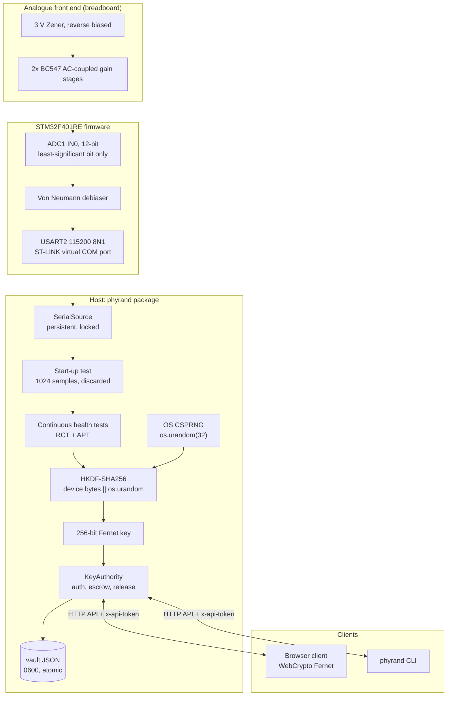
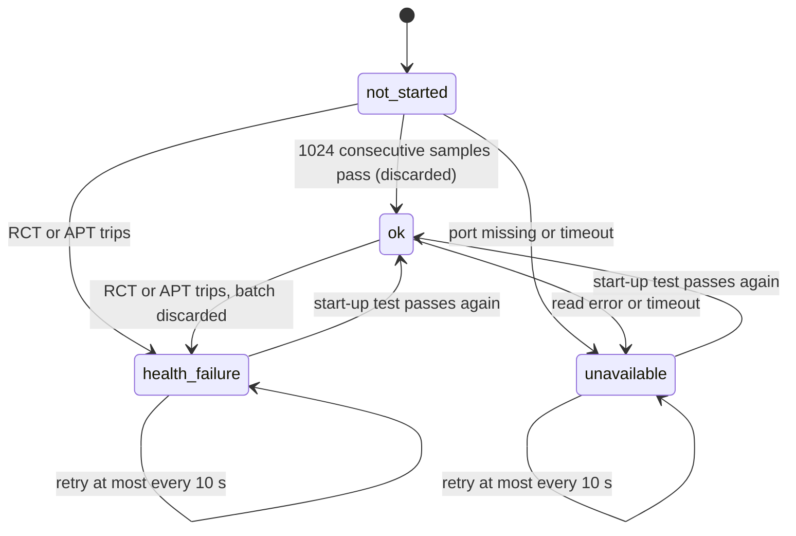
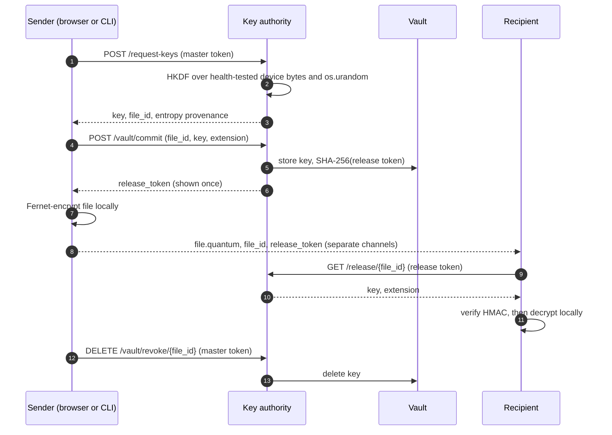

# Architecture

PhyRand has four layers. Each one treats the layer below as unreliable.



## Module map

| Path | Responsibility |
| :--- | :--- |
| `firmware/Core/Src/main.c` | Sample ADC LSB, Von Neumann debias, stream bytes over UART |
| `phyrand/health.py` | Repetition Count and Adaptive Proportion tests, cutoff calculation |
| `phyrand/conditioning.py` | HKDF-SHA256 (RFC 5869) and the hardware/OS entropy mixer |
| `phyrand/entropy.py` | `SerialSource`, `HardwareEntropy` (start-up + continuous testing, state machine), `KeyGenerator` (fail-closed policy) |
| `phyrand/vault.py` | Validated, atomic, owner-only key store; per-file release tokens |
| `phyrand/service.py` | `KeyAuthority`: authentication, rate limiting, issue / commit / release / revoke |
| `phyrand/api.py` | FastAPI transport and response hardening |
| `phyrand/client.py` | Standard-library HTTP client |
| `phyrand/filecrypt.py` | Fernet file encryption helpers |
| `phyrand/stats.py` | Standard-library entropy statistics |
| `phyrand/debias.py` | Bit-exact host model of the firmware debiaser |
| `phyrand/cli.py` | `phyrand` command |
| `static/` | Browser client: `fernet.js` (WebCrypto Fernet), `app.js`, no third-party code |
| `scripts/` | Legacy entry points, now thin wrappers around the CLI |

## The entropy pipeline

### 1. Acquisition

`SerialSource` opens the port once and keeps it open; `HardwareEntropy`
serialises access with a lock. (The original server opened the port inside
every request handler, including an unauthenticated one that returned raw
bytes to anyone.)

### 2. Health tests

`phyrand/health.py` implements the two continuous tests of NIST SP 800-90B
section 4.4 on the received bytes:

| Test | Detects | Cutoff for the default H = 4 bits/byte, alpha = 2^-20 |
| :--- | :--- | :--- |
| Repetition Count (4.4.1) | A stuck or constant source | 6 identical bytes in a row: `C = 1 + ceil(20 / H)` |
| Adaptive Proportion (4.4.2) | One value becoming too frequent | 62 occurrences in a 512-sample window: `C = 1 + CRITBINOM(512, 2^-H, 1 - alpha)` |

The cutoff code is checked against the example values in SP 800-90B
(589, 311, 177, 62, 13) in `tests/test_health.py`.



After any failure the port is closed, the batch being read is thrown away and
a complete new start-up test must pass before another byte is used.

### 3. Conditioning and mixing

```
key = HKDF-SHA256( salt = SHA256("PhyRand/v1/entropy-mix/salt"),
                   ikm  = len(hw) || hw || len(os) || os,
                   info = "PhyRand/v1/fernet-key",
                   L    = 32 )
```

* `hw` is 128 health-tested device bytes (configurable). At the assumed
  4 bits/byte that is 512 bits of assumed min-entropy for a 256-bit key.
* `os` is 32 bytes from `os.urandom`, drawn for every key.
* Device bytes are never used as a key directly. The original
  `scripts/quantum_vault.py` did exactly that, and the original API did not
  use the device at all (`secrets.token_bytes`).

Because both inputs go through HKDF-Extract together, the key is unpredictable
as long as **either** input is. A failing, biased, replayed or attacker-chosen
device stream cannot make a key weaker than an ordinary `os.urandom` key.
The mixer is deterministic given its inputs and is tested with RFC 5869
vectors and with constant "hardware" input in `tests/test_conditioning.py`.

### 4. Policy: fail closed

| `PHYRAND_REQUIRE_HARDWARE` | Board healthy | Board missing or failing |
| :--- | :--- | :--- |
| `true` (default) | key, `entropy.source = "hardware+os"` | **HTTP 503**, no key issued |
| `false` | key, `entropy.source = "hardware+os"` | key from OS only, `entropy.source = "os-only"` |

The response to `/request-keys` always states which case applied, and
`/heartbeat` reports `ONLINE`, `DEGRADED` (OS-only fallback active) or
`OFFLINE`.

## What is and is not claimed

**Claimed**

* Every issued key is 256 bits derived with HKDF-SHA256 from device bytes and
  fresh OS randomness, so it is at least as strong as an OS-generated key.
* A stuck, constant, short-period or heavily skewed device stream is detected
  and, by default, stops key issuance.
* Whether the device contributed to a key is reported, never hidden.
* File encryption is standard Fernet: AES-128-CBC with PKCS#7 padding,
  authenticated by HMAC-SHA256 (encrypt-then-MAC). The 32-byte Fernet key is a
  128-bit signing key plus a 128-bit encryption key, so confidentiality is at
  the 128-bit level.

**Not claimed**

* **Not an SP 800-90B compliant entropy source.** The standard requires health
  tests on raw noise samples and an entropy assessment of the source. Here the
  host only sees Von Neumann debiased bytes, and `H = 4` is an engineering
  assumption.
* **No proven Zener contribution.** The output could be dominated by ADC
  noise or interference; the control experiment has not been run and the
  analogue signal has never been measured (`docs/HARDWARE.md`).
* **Not a certified or "quantum" RNG.** Tunnelling is a quantum effect, but
  nothing here isolates or verifies it. Names such as `QRNG_SERIAL_PORT` and
  `.quantum` are kept only for backwards compatibility.
* **"7.9997 bits/byte" is not a security metric.** It is the Shannon entropy
  of the byte histogram of one capture, which also fails chi-square and
  monobit tests (`data/README.md`).
* **Not zero knowledge.** The server generates and stores every key. See
  `docs/THREAT_MODEL.md`.

## Key lifecycle



Notes:

* `commit` only accepts a `(file_id, key)` pair issued by `request-keys` in
  the last ten minutes, and never overwrites an entry.
* The key is escrowed **before** the file is encrypted, so a failure can
  never leave ciphertext without a stored key.
* A release token opens exactly one file ID and nothing else. The master
  token is never given to recipients (in the original design it was).
* Plaintext never leaves the client; the server only ever sees keys and
  metadata.
