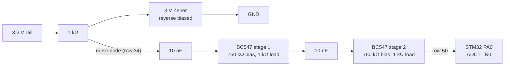
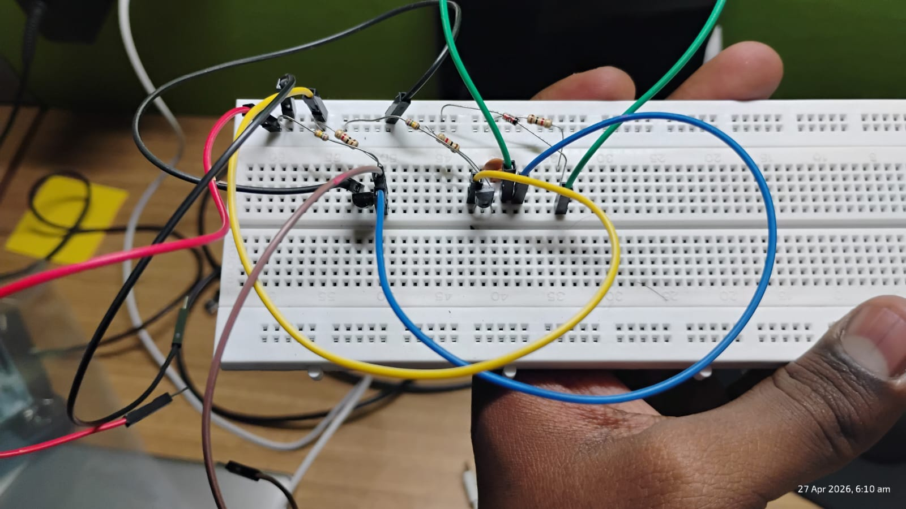
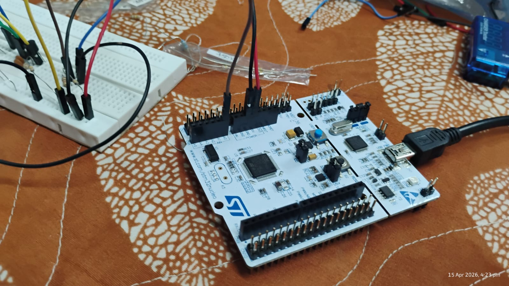

# Hardware: the Zener noise front end

The analogue front end (AFE) that produces the noise signal sampled by the
STM32. Everything here describes a **breadboard prototype**.

## 1. Signal chain

A reverse-biased Zener diode produces a small noise voltage. Two AC-coupled
common-emitter BC547 stages amplify it before it reaches the ADC pin.

A 3 V Zener breaks down mainly by the Zener (tunnelling) mechanism rather than
by avalanche multiplication, and runs here at a low current close to its knee,
because the supply is only 3.3 V. That is a deliberate constraint of running
from the Nucleo's 3.3 V pin; it also means the noise amplitude is modest (see
limitations).

### Wiring table

| Section | Component | From | To |
| :--- | :--- | :--- | :--- |
| **Core** | 1 kΩ resistor | 3.3 V pin | Row 34 |
| **Core** | 3 V Zener diode | Row 34 | GND rail |
| **Stage 1** | 10 nF capacitor | Row 34 | Row 41 (base 1) |
| **Stage 1** | 750 kΩ bias | 3.3 V rail | Row 41 (base 1) |
| **Stage 1** | 1 kΩ load | 3.3 V rail | Row 40 (collector 1) |
| **Stage 2** | 10 nF capacitor | Row 40 | Row 51 (base 2) |
| **Stage 2** | 750 kΩ bias | 3.3 V rail | Row 51 (base 2) |
| **Stage 2** | 1 kΩ load | 3.3 V rail | Row 50 (collector 2) |
| **Interface** | Jumper wire | Row 50 | STM32 pin PA0 (Arduino A0) |

Both emitters go to the GND rail.

## 2. Bill of materials

| Qty | Part | Notes |
| :-- | :--- | :--- |
| 1 | STM32 NUCLEO-F401RE | MCU board with on-board ST-LINK (programming + virtual COM port) |
| 2 | BC547 NPN transistor | Common-emitter gain stages |
| 1 | 3 V Zener diode | Noise source |
| 2 | 10 nF ceramic capacitor (marked `103`) | Inter-stage AC coupling |
| 3 | 1 kΩ resistor | Zener series resistor and two collector loads |
| 2 | 750 kΩ resistor | Base bias |
| 1 | Solderless breadboard, jumper wires | |

## 3. Photos

| Breadboard front end | Nucleo connections |
| :---: | :---: |
|  |  |

More angles: [breadboard 2](images/breadboard-connections-2.jpeg),
[3](images/breadboard-connections-3.jpeg),
[4](images/breadboard-connections-4.jpeg),
[5](images/breadboard-connections-5.jpeg),
[6](images/breadboard-connections-6.jpeg),
[Nucleo 2](images/stm32f401re-connections-2.jpeg).

## 4. Design estimates (calculated, not measured)

These follow from the component values and typical BC547 parameters. They are
a sanity check of the design, **not** bench measurements.

| Quantity | Estimate | Basis |
| :--- | :--- | :--- |
| Zener current | at most about 0.3 mA | (3.3 V - 3.0 V) / 1 kΩ; lower in practice because a 3 V Zener has a soft knee |
| Base bias current per stage | about 3.5 µA | (3.3 V - 0.65 V) / 750 kΩ |
| Collector current per stage | about 0.7 - 1.4 mA | for a current gain of 200 - 400; the operating point depends directly on the transistor's gain |
| Coupling high-pass corner | low kHz range | 10 nF into a few kΩ of base input resistance |

Because the bias is a single base resistor, the operating point moves with
transistor gain and temperature. That is acceptable for a prototype and is one
reason a PCB revision with emitter degeneration is on the roadmap.

## 5. Bring-up log

| Phase | Problem | Root cause | Fix |
| :--- | :--- | :--- | :--- |
| **Power** | Dead breadboard section | Split power rails | Added a jumper bridge |
| **Zener** | No breakdown | 5.1 V Zener cannot break down from a 3.3 V supply | Swapped to a 3 V Zener |
| **Amp** | Stage 1 saturated | Base current too high | Increased bias resistor to 750 kΩ |
| **Amp** | Stage 2 cut off | Emitter was floating | Fixed the GND connection on row 52 |
| **Verification** | 0.0 V AC reading | A multimeter is too slow for wide-band noise | Touch ("human antenna") test only, which is not a valid characterisation |

## 6. Digital sampling path

The amplified signal leaves the second stage at **row 50** and enters the
STM32 at **PA0**. The firmware takes the least-significant bit of each 12-bit
conversion, applies Von Neumann debiasing and streams the resulting bytes over
the ST-LINK virtual COM port at 115200 baud. See
[`firmware/README.md`](../firmware/README.md).

A 1 MB capture of that stream measures 7.9997 bits/byte Shannon entropy with
`ent`. That and the other statistics, including the tests the capture fails,
are in [`data/README.md`](../data/README.md).

## 7. Known limitations of the hardware

* **The analogue noise has never been measured.** No oscilloscope or spectrum
  analyser was used; amplitude, bandwidth and spectrum at PA0 are unknown.
  All validation so far is statistical, on the digital output.
* **Zener contribution is unproven.** Using only the ADC's LSB means ADC
  noise alone could produce a similar-looking stream. The control experiment
  (same capture with the Zener removed) has not been run.
* **No shielding, filtering or supply decoupling.** A high-gain breadboard
  amplifier picks up mains hum and RF, and shares the 3.3 V rail with the
  MCU's digital switching noise. Interference is not entropy and may be
  observable or influenceable by an attacker nearby.
* **No temperature or supply-variation testing.**

`TODO(verify on hardware)`: scope capture at the noise node and at PA0,
amplitude histogram of raw 12-bit samples, and the Zener-removed control run.
