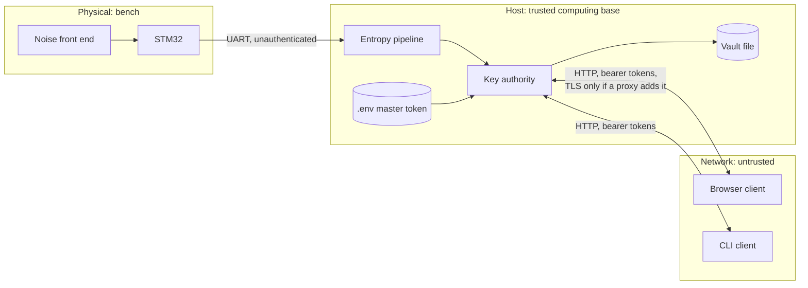

# Threat model

Scope: the prototype as it exists in this repository, a single-user
key-escrow service fed by a breadboard noise source. It is a learning and
portfolio project and has had no external security review.

## What the system is

PhyRand is a **key-escrow service**. The server generates every file key,
keeps a copy and hands it to anyone who presents the right token. Files are
encrypted and decrypted on the client, so the server never sees plaintext,
but it can decrypt any file whose key it still holds.

Earlier documentation called this "zero-knowledge" and a "decentralized key
authority". Neither was accurate: the server knows every key, and there is
exactly one server. The wording has been corrected rather than the design
changed, because escrow with revocation is the feature the project
demonstrates.

## Assets

| Asset | Where it lives | Compromise means |
| :--- | :--- | :--- |
| File keys | `vault/quantum_vault.json` (plaintext, mode 0600), server memory, briefly in clients | Decryption of the matching files |
| Master token | `.env` on the server, sender's memory / browser tab | Full control: issue, list, release and revoke every key |
| Release tokens | Recipient only; server stores SHA-256 digests | Decryption of one file |
| Plaintext files | Client devices only | Direct disclosure |
| Entropy quality | Noise source, firmware, host pipeline | Predictable keys, if the OS CSPRNG were also broken |

## Trust boundaries

The host (OS, Python runtime, `.env`, vault file) is fully trusted. The serial
link and the network are not.

## Adversaries considered

| Adversary | Capability |
| :--- | :--- |
| Network attacker | Can reach the API port; can observe or modify traffic if TLS is absent |
| Curious recipient | Holds one valid release token and file ID |
| Malicious web content | Controls a file name, or data previously stored in the vault |
| Physical attacker at the bench | Can unplug or swap the board, inject signals into the amplifier, or attach to the UART |
| Thief of storage | Obtains a copy of the vault file or a backup |

Out of scope: a compromised host or browser, side channels on the host,
denial of service, and anything requiring a certified entropy source.

## Threats, mitigations and residual risk

### Entropy source

| Threat | Mitigation in this repository | Residual risk |
| :--- | :--- | :--- |
| Source fails silent or stuck (wire off, amplifier saturated) | Debiaser emits nothing for constant input, so the host times out; Repetition Count test; fail closed by default | None for key strength. Availability is lost until the board recovers. |
| Source degrades (bias, mains hum, periodic pattern) | Adaptive Proportion test on output bytes; HKDF conditioning; OS mixing | Small biases, like the one measured in the reference capture, are **not** detected. They do not weaken keys because of the OS mix, but they mean the device's real contribution is unquantified. |
| Attacker replaces the board or injects a chosen byte stream over UART | Keys are `HKDF(device bytes, os.urandom)`, so chosen device input cannot make keys predictable | The device then contributes nothing and the health tests cannot tell. No device authentication exists. |
| Attacker injects EM or supply noise to bias the source | Same as above | Same as above; the unshielded high-gain breadboard is easy to influence. |
| Attacker eavesdrops on device bytes (UART tap, EM) | OS mix | Device bytes must be assumed observable to a local attacker. |
| Unauthenticated user drains or reads the stream | `/heartbeat` no longer returns raw bytes or reads on demand; the port is opened once and all reads go through a lock; status probes are rate limited | None known. |
| Health tests give false assurance | Documentation states they run on debiased output with an assumed `H`, and are not SP 800-90B compliant | A reader may still over-trust "health: ok". |

### API and server

| Threat | Mitigation in this repository | Residual risk |
| :--- | :--- | :--- |
| Default or guessable master token (was `"password"`) | Server refuses to start without a token of at least 32 characters that is not a placeholder; `phyrand token` generates one | Operator can still leak it. |
| Token brute force / timing | Constant-time comparison (`hmac.compare_digest` over SHA-256 digests); 10 failed attempts per client per minute, then HTTP 429 | The limiter is in-memory, per source address. Behind a proxy all clients share one address unless the proxy is configured to pass and the app to trust the client address. |
| Bearer token theft on the wire | Server binds to `127.0.0.1` by default and warns on other addresses; CLI refuses plain HTTP to non-loopback hosts | **No built-in TLS.** Remote use needs an HTTPS reverse proxy. Exposing the port through a public tunnel puts the master token one guess-limit away from the internet. |
| Recipients need the master token (original design) | Per-file release tokens: 256-bit random, stored hashed, valid for one file ID only | Release tokens do not expire and are reusable until the key is revoked. |
| Vault listing leaks keys (original `/vault/list` returned them) | Listing returns ID, extension and creation time only | None known. |
| File-ID enumeration | Unknown ID and wrong token give the same 401 unless the caller holds the master token; IDs are 48-bit random | IDs are identifiers, not secrets. |
| Client plants or overwrites keys via `/vault/commit` | Only pairs issued by `/request-keys` in the last 10 minutes are accepted; existing IDs are never overwritten | None known. |
| Injection through `file_id` / `extension` (stored unchecked, echoed into HTML and file names) | Strict allow-lists (`[A-Z0-9]{6,32}`, `[A-Za-z0-9]{1,16}`); anything else is rejected or replaced by `bin`; neither value is ever used as a server-side path | None known. |
| Vault corruption on crash (non-atomic write lost every key) | Temp file + `fsync` + `os.replace`; a corrupt file raises an error instead of being treated as empty | No backups, no multi-process locking: run a single worker. |
| Vault file read by another local user | Directory 0700, file 0600 | **Keys are stored in plaintext.** Anyone with host or backup access can decrypt everything. |
| Cross-origin abuse | No CORS headers unless origins are explicitly configured; `*` is rejected; no cookies, so no CSRF surface | None known. |
| Key material cached by intermediaries | `Cache-Control: no-store` on every response; key issuance prefers POST | GET `/request-keys` is still accepted for backwards compatibility. |
| Event-loop stall from blocking serial reads | Endpoints are synchronous functions run in the thread pool | A slow board can occupy worker threads for up to the serial timeout. |

### Browser client

| Threat | Mitigation in this repository | Residual risk |
| :--- | :--- | :--- |
| Stored XSS through vault data (IDs and extensions were concatenated into `innerHTML` and inline `onclick`) | DOM built with `textContent` and `addEventListener`; server-side allow-lists; `Content-Security-Policy: default-src 'self'` with no inline script | None known. |
| Third-party script compromise (CryptoJS and fonts were loaded from CDNs without integrity hashes) | No third-party resources at all; Fernet is implemented on the browser's WebCrypto API | The page itself is served by the key authority, so the server must be trusted to serve honest JavaScript. That is consistent with it already holding every key. |
| Unauthenticated decryption (original client decrypted without checking the HMAC) | HMAC-SHA256 verified by WebCrypto before any decryption; tested against the Fernet spec vectors | None known. |
| Token or key persistence in the browser | Held in memory only; nothing is written to storage or cookies | Tokens remain in page memory and form fields until the tab closes. |
| Clickjacking | `X-Frame-Options: DENY`, `frame-ancestors 'none'` | None known. |

### Cryptography

| Property | Status |
| :--- | :--- |
| Algorithm | Fernet: AES-128-CBC, PKCS#7, HMAC-SHA256, encrypt-then-MAC |
| Security level | 128-bit confidentiality, 128-bit authentication key |
| Key derivation | HKDF-SHA256 (RFC 5869 vectors in the tests) |
| Limits | Whole file in memory; no streaming; no key rotation; the Fernet timestamp is not used for expiry |
| Post-quantum | 128-bit symmetric keys are not considered long-term quantum-safe; no claim is made |

## Priorities for hardening

1. Wrap vault entries under a key that is not stored next to them.
2. Terminate TLS in front of the API and document a reference proxy setup.
3. Expiring and single-use release tokens; audit log of releases.
4. Authenticate the device, or at least frame its output with health status.
5. Raw-sample capture and the SP 800-90B assessment that would justify an
   entropy claim.
